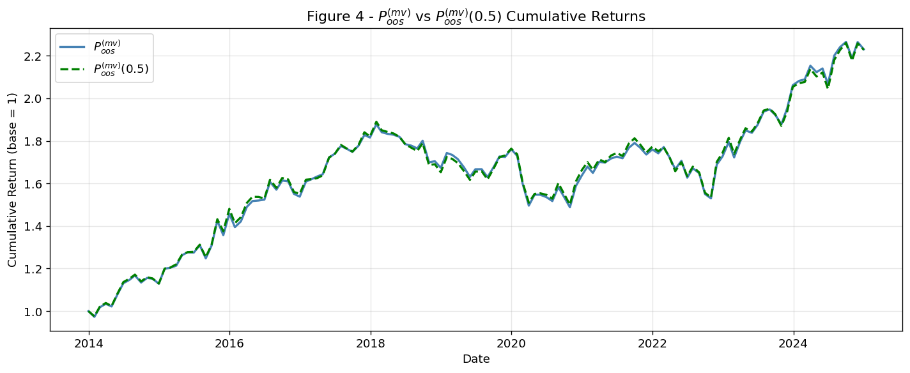
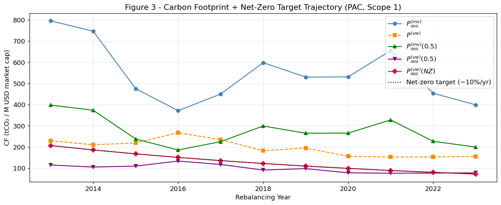

# Carbon-Aware Portfolio Allocation — Asia-Pacific Equities

How much does it cost to halve the carbon footprint of an equity portfolio? This project builds out-of-sample minimum-variance and benchmark-tracking portfolios on Pacific-region stocks from 2014 to 2024, then adds carbon constraints and a net-zero trajectory and measures what they cost in risk and return.

Group project, MSc in Finance, HEC Lausanne — *Sustainability Aware Asset Management*, 2026.

## Key findings

- **Halving the carbon footprint cost almost nothing.** The constrained minimum-variance portfolio cut its average carbon footprint from 545.8 to 272.9 tCO₂ per million USD of market cap, while its Sharpe ratio moved only from **0.546 to 0.536**.
- **For an index investor, it was free.** Minimising tracking error under a 50% carbon cap kept the portfolio almost identical to the benchmark and slightly improved its Sharpe ratio (**0.265 to 0.271**). The net-zero path (−10% per year) gave a Sharpe ratio of 0.270.
- **Minimum variance beat the cap-weighted benchmark out of sample:** 7.56% annualised return against 5.21%, with lower volatility (10.89% against 13.53%).

| Portfolio | Ann. return | Ann. volatility | Sharpe | Avg carbon footprint |
|---|---|---|---|---|
| Minimum variance | 7.56% | 10.89% | 0.546 | 545.8 |
| Value-weighted benchmark | 5.21% | 13.53% | 0.265 | 195.8 |
| Minimum variance, −50% carbon | 7.55% | 11.07% | 0.536 | 272.9 |
| Benchmark tracking, −50% carbon | 5.30% | 13.57% | 0.271 | 97.9 |
| Benchmark tracking, net zero | 5.28% | 13.59% | 0.270 | 128.8 |

Monthly out-of-sample returns, January 2014 – December 2024. Sharpe ratios use the 3-month US Treasury bill rate (FRED TB3MS). Carbon footprint in tCO₂ per million USD of market capitalisation, Scope 1 emissions.





## Method

| Step | What is done |
|---|---|
| Universe | Pacific-region equities with Scope 1 emissions, revenue and market cap available. |
| Cleaning | Exclusion list, prices below 0.50 treated as missing, stale-price filter, delisted firms given a −100% return in their exit month. |
| Estimation | 120-month rolling window, annual rebalancing every December from 2013 to 2023. Ledoit-Wolf shrinkage keeps the covariance matrix full rank once the number of stocks exceeds the window. |
| Optimisation | Long-only quadratic programs solved with CVXPY: minimum variance, and tracking-error minimisation against the value-weighted benchmark. |
| Carbon | Weighted-average carbon intensity (per revenue) and carbon footprint (per market cap); a 50% footprint cap and a net-zero path cutting the cap by 10% a year. |
| Look-ahead | Benchmark weights lagged one month; every allocation uses only data available at rebalancing. |

One result needs care when reading the charts: the carbon cap applies to the footprint (emissions per market cap), not to the weighted-average carbon intensity (emissions per revenue). The constrained minimum-variance portfolio can therefore show a high intensity in some years while meeting its footprint target.

## Run it

```bash
python -m venv venv
venv\Scripts\activate          # macOS/Linux: source venv/bin/activate
pip install -r requirements.txt
jupyter notebook carbon_aware_portfolio.ipynb
```

The emissions and market dataset (`Sustainability.xlsx`) was provided by the course and is not redistributed here. Place it next to the notebook to rerun the analysis. The risk-free series comes from FRED and is included.

## Repository structure

```text
carbon-aware-portfolio/
├── carbon_aware_portfolio.ipynb     # full analysis, top to bottom
├── figures/                         # all figures produced by the notebook
├── risk_free_tb3ms_2014_2024.csv    # 3-month T-bill rate (FRED)
└── requirements.txt
```

## Team and contribution

Four-person project. I built the full analysis pipeline — data cleaning, out-of-sample optimisation and carbon constraints — using Claude Code as a development partner: I defined the implementation choices, reviewed and debugged every module, and reworked parts of the code. My three teammates wrote the report.
